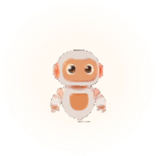
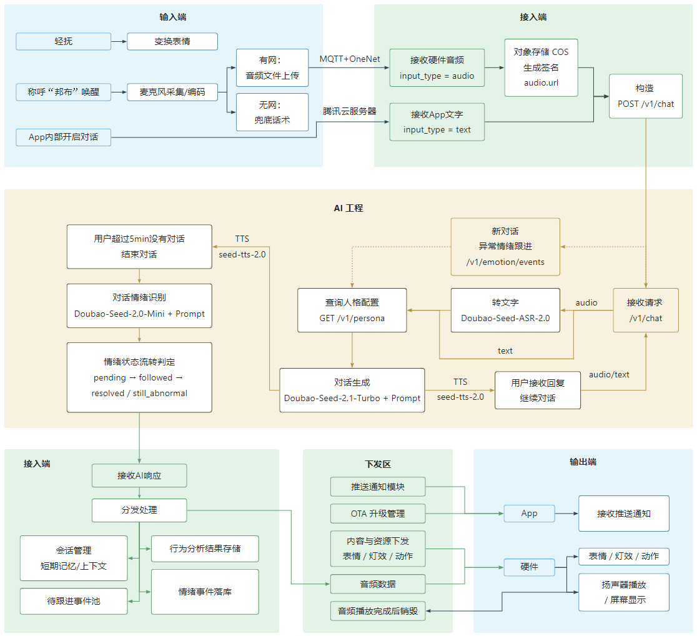
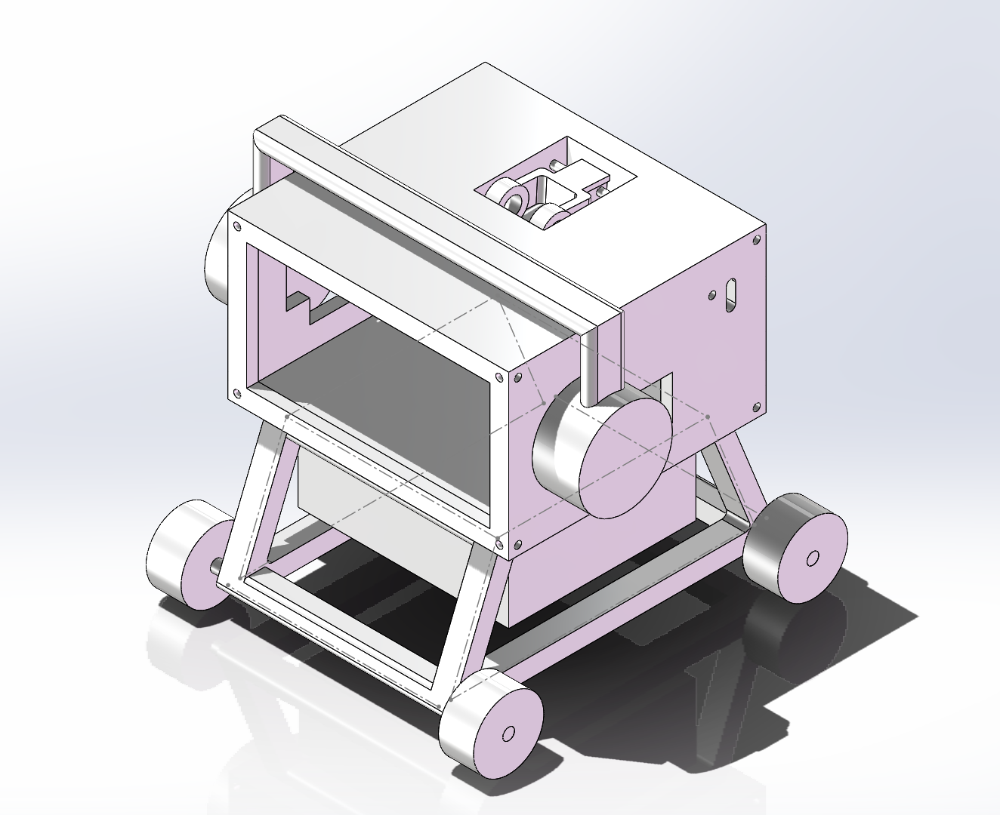
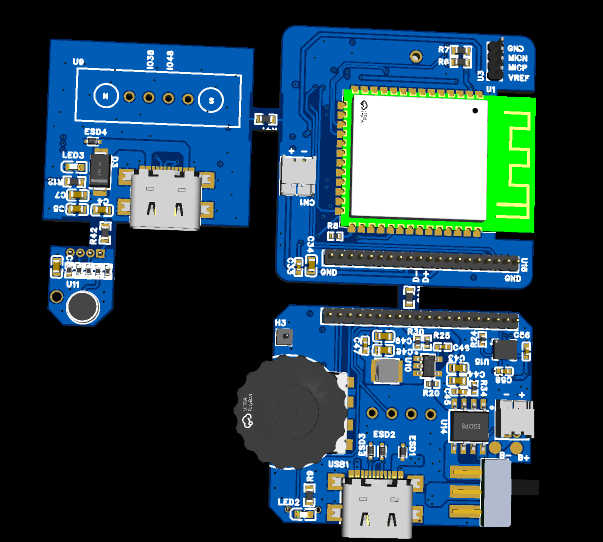

# BangBuAI · 邦布

### 深度情感陪伴 × 轻量生活助理

一款由 Android App 与桌面硬件共同组成的 AI 陪伴产品。 
<strong>用户需要时响应，不需要时安静陪伴。</strong>

 

[简体中文](README.md) · [English](README_EN.md)

 

---

## 项目概览

邦布（BangBu）探索一种更自然、低打扰的日常陪伴方式：用户可以通过文字或语音表达当下状态，AI 结合有限上下文提供回应；App 与桌面设备共同承载对话、情绪记录和轻量生活功能。

项目覆盖产品定义、AI 工作流与服务适配、App 交互设计和硬件原型。仓库按作品集方式组织，分别呈现产品思考、AI 工程实现、App 设计入口和硬件设计素材。

> 当前展示对应 V1.0 Demo 阶段。文档中的规划、目标和设计方案不自动代表已上线或已验证能力；具体状态以对应目录说明为准。

## 产品与技术框架

 
从 App / 硬件输入，经 AI 工作流与业务服务，再到 App / 设备输出的端到端链路

### 核心体验

- **自然表达**：支持文字与语音输入，AI 根据当前对话上下文生成回应。
- **持续陪伴**：通过用户明确表达的偏好和近期上下文，让互动不止于单轮问答。
- **情绪记录与跟进**：将对话中的情绪信号转为可回顾事件，并在后续交互中适度跟进。
- **轻量生活助理**：围绕计时、提醒等场景提供有限、可控的辅助能力。
- **软硬件协同**：App 承载设置与记录，桌面设备提供更有存在感的语音和多模态反馈。

## 仓库导航

| 目录 | 展示内容 |
|---|---|
| [pm/](pm/README.md) | AI 产品经理作品集：用户问题、产品定位、AI 方案、指标评估、安全边界与项目复盘 |
| [ai/](ai/README.md) | AI 工程样例：LangGraph 工作流、节点拆分、Prompt、模型与业务服务适配 |
| [app/](app/README.md) | Android App 产品设计、关键流程与 Figma 原型入口 |
| [hardware/](hardware/) | 桌面硬件原型、PCB 与外壳设计素材 |

## AI 工程看点

AI 侧不只是一次模型 API 调用，而是把输入、上下文、工具与输出组织成一条可演进的工程链路：

<strong>文字 / 音频输入 → ASR（音频时）→ 会话上下文与待跟进状态 → 工具意图路由</strong> 
<strong>普通对话 → 记忆召回 → 模型生成 → TTS → 情绪分析 → 事件与记忆更新</strong>

- 使用 **LangGraph** 显式表达对话节点、条件分支及独立情绪分析流程。
- 通过服务适配层隔离模型、ASR、TTS 与业务后端；Mock 模式支持脱离真实密钥进行开发和演示。
- 将工具能力限制在明确范围内，对有外部副作用的操作设计草稿与确认边界。
- 对请求重试、后端错误、超时及 TTS 派发状态进行显式处理，避免把“请求已接受”误当成“设备已播放”。
- 通过 Prompt、状态、业务逻辑和服务连接的分层，便于独立迭代与测试。

> ai/ 是经过挑选的工程展示目录，不包含完整 API、持久层和部署配置，因此不是开箱即用的完整服务包。

## 硬件原型

 
桌面机器人外壳与电路板设计展示

## 个人贡献

- **产品定义**：梳理目标用户、核心场景、需求优先级、V1.0 范围和非目标。
- **AI 产品与工程协作**：推动 Prompt、Agent 工作流、Tool 和 Memory 等能力进入可实现、可联调的方案。
- **体验设计**：负责 App 端 UI / 交互设计，并跟进设计与实现的一致性。
- **跨团队推进**：协同 App 前后端及 AI 接口联调，跟进依赖、问题和 Demo 交付。
- **风险与评估**：梳理情绪标签、效果评测、安全隐私边界和后续验证方向。

更多职责与阶段说明见 [项目摘要与个人贡献](pm/00_项目摘要与个人贡献.md)。

## 产品边界

- 邦布是 AI 陪伴原型，不是心理诊断、治疗或危机干预服务。
- 情绪识别是存在不确定性的产品信号，不是临床量表或对用户状态的事实判断。
- 对外部业务产生影响的动作应有明确权限、确认与失败反馈；AI 不应被描述为可任意控制硬件、发布内容或消费下单。
- 情绪、对话、语音和记忆可能涉及敏感数据；实际产品需要清晰告知、最小化收集、访问控制和删除机制。

BangBuAI · A thoughtful companion, present when needed.

