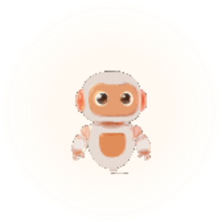
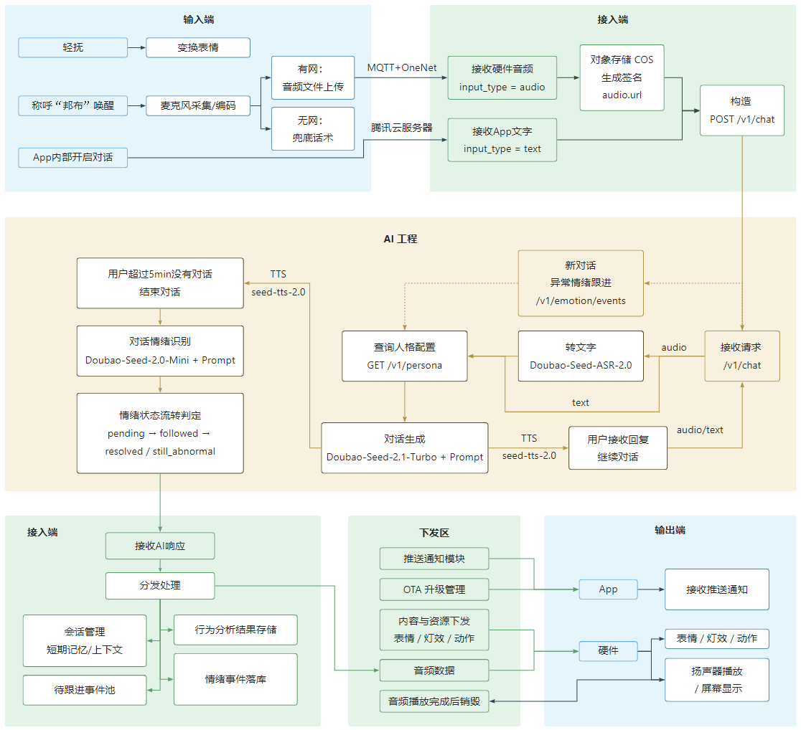
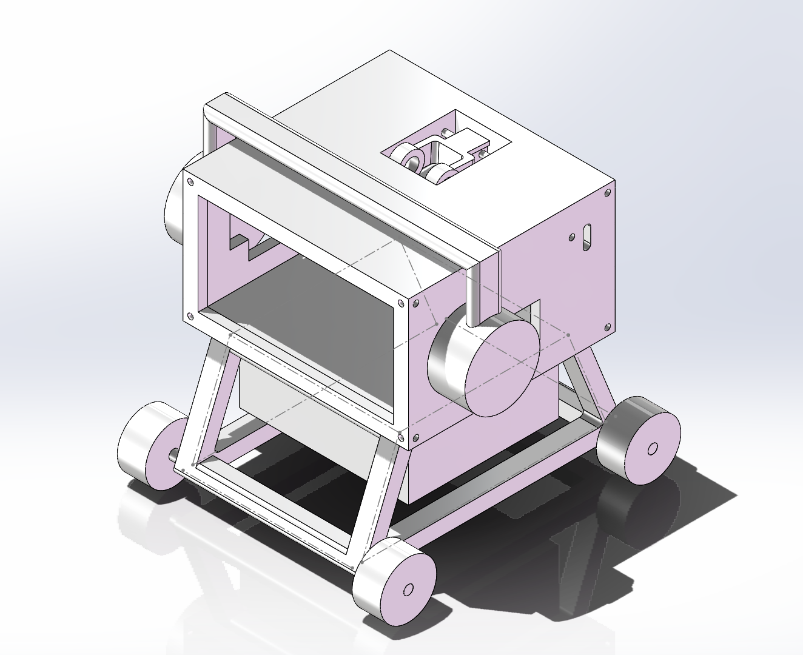
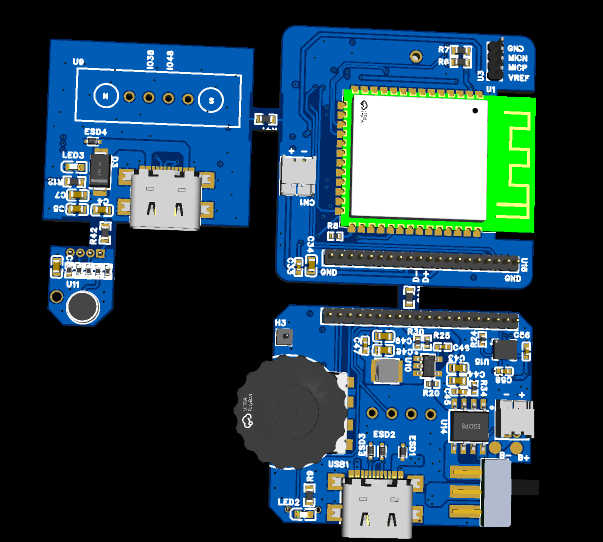

# BangBuAI

### Emotional companionship × lightweight everyday assistance

An AI companion experience spanning an Android app and a desktop robot. 
<strong>There when you need it, quiet when you don't.</strong>

 

[简体中文](README.md) · [English](README_EN.md)

 

---

## Overview

BangBu explores a more natural, low-pressure form of everyday companionship. Users can express themselves through text or voice, while the AI responds using limited conversational context. The app and desktop device work together to support conversation, emotion journaling, and lightweight assistance.

The project spans product definition, AI workflow and service integration, app interaction design, and hardware prototyping. This repository is organized as a portfolio, with separate areas for product work, AI engineering samples, app design, and hardware assets.

> This showcase reflects the V1.0 demo stage. Roadmap items, goals, and design proposals should not be interpreted as shipped or validated capabilities; see each directory for its current scope.

## Product & Technical Architecture

 
End-to-end flow from app and device input through AI orchestration and backend services to app and device output

### Core Experience

- **Natural interaction:** Text and voice input with context-aware responses.
- **Continuity:** User-shared preferences and recent context help interactions go beyond one-off chat.
- **Emotion journaling and follow-up:** Conversation signals can become reviewable events and inform considerate follow-ups.
- **Lightweight assistance:** Bounded support for everyday scenarios such as timers and reminders.
- **App + device:** The app handles settings and records while the desktop device adds a more tangible voice and multimodal presence.

## Repository Guide

| Directory | What it contains |
|---|---|
| [pm/](pm/README.md) | AI product portfolio: user problems, product positioning, AI approach, evaluation, safety, and project retrospectives |
| [ai/](ai/README.md) | AI engineering samples: LangGraph workflows, node separation, prompts, model and backend adapters |
| [app/](app/README.md) | Android app product design and Figma prototype |
| [hardware/](hardware/) | Desktop device prototype, PCB, and enclosure design assets |

## AI Engineering Highlights

The AI layer is more than a single model API call: it organizes inputs, context, tools, and outputs into an evolvable workflow.

<strong>Text / audio input → ASR (for audio) → session context and pending follow-up → tool intent routing</strong> 
<strong>Regular dialogue → memory recall → model response → TTS → emotion analysis → event and memory update</strong>

- **LangGraph** expresses conversation nodes, conditional branches, and a separate emotion-analysis flow.
- Service adapters isolate model, ASR, TTS, and business-backend integrations. Mock mode supports development without real credentials.
- Tool capabilities are bounded; actions with external side effects are designed around drafts and explicit confirmation.
- Retries, backend errors, timeouts, and TTS dispatch states are handled explicitly, so “accepted” is not confused with “played on device.”
- Prompts, workflow state, business logic, and service integrations are separated for focused iteration and testing.

> The ai/ directory is a curated engineering showcase. It does not include the complete API, persistence layer, or deployment configuration and is not a standalone service package.

## Hardware Prototype

 
Enclosure and circuit board design explorations

## My Contributions

- **Product definition:** Target users, core scenarios, prioritization, V1.0 scope, and non-goals.
- **AI product and engineering collaboration:** Turning prompts, agent workflows, tools, and memory into implementable and integrable designs.
- **Experience design:** App UI and interaction design, with follow-through on implementation consistency.
- **Cross-functional delivery:** Coordinating app/backend work and AI integration, tracking dependencies and demo delivery.
- **Evaluation and safety:** Emotion taxonomy, evaluation planning, privacy and safety boundaries, and next validation steps.

See [Project Summary & Contributions](pm/00_%E9%A1%B9%E7%9B%AE%E6%91%98%E8%A6%81%E4%B8%8E%E4%B8%AA%E4%BA%BA%E8%B4%A1%E7%8C%AE.md) for the detailed contribution summary.

## Product Boundaries

- BangBu is an AI companion prototype, not a diagnostic, therapeutic, or crisis-intervention service.
- Emotion recognition is an uncertain product signal, not a clinical measure or factual judgment about a user.
- Actions with external impact require clear authorization, confirmation, and failure handling. The AI should not be presented as having unrestricted control over devices, publishing, or purchases.
- Emotion, conversation, voice, and memory data may be sensitive. A real product needs clear notice, data minimization, access controls, and deletion mechanisms.

BangBuAI · A thoughtful companion, present when needed.

